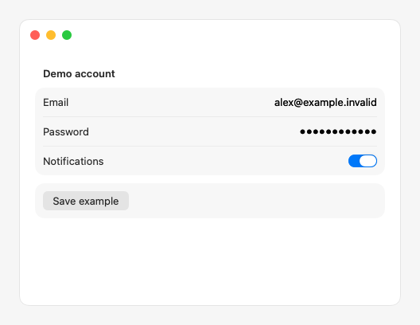
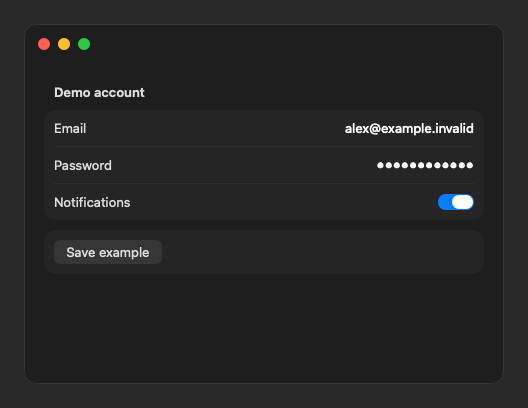

# SwiftUI Component Preview

A standalone agent skill for Claude Code, Codex, and other [Agent Skills](https://agentskills.io/specification) runtimes. It discovers a project's SwiftUI sources and has the agent adapt the requested real component into a local fixture. Render macOS-compatible components as PNGs using a detached `NSHostingView`, compare images in an offline HTML gallery, or build an interactive native preview window. PNGs and galleries can be shown in the agent's file, image, or browser panel; the live preview is a separate macOS window. Optional framing in static renders is decorative.

| Light, with the decorative frame | Dark, with the decorative frame |
| --- | --- |
|  |  |

PNG renders of the bundled `assets/ExampleFixture.swift` at 480 × 320, produced by `scripts/render.sh` exactly as shown under [Try the example](#try-the-example).

## What to ask for

Name the output to choose it: `png`, `gallery`, or `live`, as in `/swiftui-component-preview live SettingsView`. Without one the agent infers it from the request (looks → PNG, comparing themes → gallery, clicking through → live window), defaults to a PNG for a single component, and asks for a whole screen with no hint.

On first use the skill inspects the project and adapts the real component into a project-local fixture, saving relative-path configuration in `.swiftui-preview/` for later calls. UIKit-only screens and complex project dependencies need a Simulator or a project-specific workflow.

## Requirements

macOS 14 or later and Xcode 15 or later (Swift 5.9+) with its command-line tools. Swift 6 is not required: builds use Swift 6 language mode with strict concurrency when the compiler has it and Swift 5 mode otherwise, and `--swift-version 5` (or `PREVIEW_SWIFT_VERSION=5`) forces Swift 5 mode for fixtures adapted from Swift 5 projects. Project onboarding, galleries and live builds additionally require Python 3.8 or later. No third-party packages. The helpers execute supplied Swift code with your normal permissions, so use trusted, self-contained fixtures with synthetic data. Static actions can be inert; live fixtures can use view-local state, validation and navigation. macOS-compatible SwiftUI components share the same fixture API across projects. UIKit-only components need an iOS Simulator/Canvas workflow; project modules, assets and String Catalogs need an explicitly adapted build.

## Install

Keep `SKILL.md`, `references/`, `scripts/`, and `assets/` together; `agents/openai.yaml` is Codex UI metadata that other agents ignore. No MCP server is required.

### Claude Code

Any one of:

```bash
npx skills add kvyatkovskys/KVKAgentSkills --skill swiftui-component-preview --agent claude-code --global
```

```text
/plugin marketplace add kvyatkovskys/KVKAgentSkills
/plugin install apple-dev@kvk-agent-skills
```

Or copy this `swiftui-component-preview` directory into `~/.claude/skills/` (all projects) or `<project>/.claude/skills/` (one project). Start a new session, then run `/swiftui-component-preview Show a preview of SettingsView` or simply ask for a SwiftUI component preview. Installed from the plugin marketplace, the command is `/apple-dev:swiftui-component-preview`.

Claude Code asks for permission before running the helper scripts. They invoke `python3`, `bash`, and `xcrun swiftc` and write only to the output path you choose, a temporary directory, and `.swiftui-preview/` in the project.

### Codex

Copy this `swiftui-component-preview` directory into `${CODEX_HOME:-$HOME/.codex}/skills/`, or use `npx skills add ... --agent codex`. Refresh Codex's skill list or restart Codex, then invoke `$swiftui-component-preview` or ask for a SwiftUI component render.

### Shared behavior

Each developer installs the same directory in their own skill location. There are no personal project paths, per-developer preferences, or machine-specific settings to edit. Use the skill from any project root; the first preview request discovers the project and has the agent inspect and adapt the requested component, including its existing preview inputs. It saves the fixture and `.swiftui-preview/config.json` in that project, never in the installed skill. The configuration uses relative paths and moves with a checkout. Source or fixture edits invalidate the saved hashes and require inspection and adaptation again. The agent handles routine adaptation; unsupported platform or dependency needs are reported explicitly.

For example, after the agent prepares a genuine fixture:

```bash
python3 "<skill-directory>/scripts/bootstrap.py" discover --root "<project-root>"
python3 "<skill-directory>/scripts/bootstrap.py" configure --root "<project-root>" \
  --project "Package.swift" --source "Sources/StatusCard.swift" \
  --fixture ".swiftui-preview/fixtures/StatusCard.swift" --component StatusCard
python3 "<skill-directory>/scripts/bootstrap.py" run --root "<project-root>" \
  --mode render --output "/absolute/task-output/card.png" --width 480 --height 320
```

Discovery reads text only and does not evaluate SwiftPM manifests, plugins or build commands. Configuration records the agent's selected paths and source/fixture hashes; it cannot prove the adaptation is faithful. Bootstrap rejects existing output paths, unsafe selected paths, symlinks and malformed or stale configuration. Read [SKILL.md](SKILL.md) for first-use selection, adaptation and subsequent previews.

## Try the example

From this directory:

```bash
mkdir -p /tmp/component-renders
bash scripts/render.sh assets/ExampleFixture.swift /tmp/component-renders/example.png 480 320 light en_US --frame
bash scripts/render.sh assets/ExampleFixture.swift /tmp/component-renders/example-dark.png 480 320 dark en_US
bash scripts/gallery.sh assets/ExampleFixture.swift /tmp/component-renders/gallery.html 480 320 en_US "Account preferences"
```

Pass `fit` instead of a width or height to size the PNG to the component, for example `390 fit` for a list row; the measured size is printed to stderr. The framed example is 528 × 408 pixels; its content viewport remains 480 × 320. The unframed example is 480 × 320. See [SKILL.md](SKILL.md) for the fixture entry point, resource limitations, and presentation workflow.

Open `gallery.html` in a browser to select Light or Dark and toggle the decorative frame. All four images are embedded: no server, network access, or downloaded assets are needed by the gallery itself. Its controls switch actual SwiftUI renders; controls inside the image remain static. Claude Code can open it with `open` or a browser tool; Codex can open it in its right panel using `open_in_codex` with `target: "browser"` when supported. Local-file support varies by browser; a permitted local preview server can serve an artifact-only directory on `127.0.0.1`. See the skill instructions for that fallback.

A project can register a second, stateful fixture for the live window with `configure --live-fixture`; render and gallery keep using the static one. There is no hot reload; after the agent updates the fixture, `bootstrap.py refresh --root <project> --output <same .app>` rebuilds in place, closes the old window and reopens it, losing view-local state. To build an interactive sample (without launching it):

```bash
bash scripts/live.sh assets/LiveExampleFixture.swift \
  "/tmp/component-renders/SwiftUI Preview.app" 640 480 en_US
```

The `.app` path must be new and its parent must exist. Open the generated app when launch is authorized and permitted. Use Get started, edit the synthetic fields, change the plan and seats, open the notification preferences sheet, try the simulated error alert, continue to success, push View details, and use Start over with its confirmation dialog. About this demo on the welcome screen opens another sheet. A glass bar beneath the content viewport offers System/Light/Dark, initial/English/Russian locales, the live viewport size, and Reset; the window is resizable and clicking the size restores the configured one. Locale injection uses resources supplied by the fixture; it does not add translations. Reset recreates view-local state and does not undo effects elsewhere. Source edits never reach an open window: rebuild with `bootstrap.py refresh` in a configured project, or build again at a new path. See [SKILL.md](SKILL.md) for isolation boundaries and resource limitations.

The tests live outside the installable skill, in `tests/swiftui-component-preview/` at the repository root. To verify the renderer and argument handling on a Mac, run from the repository root:

```bash
bash tests/swiftui-component-preview/run.sh
```

The tests use temporary files, check PNG dimensions and distinct theme images, reject invalid arguments, and verify failure cleanup. The gallery test also verifies title escaping, quoted paths, and preservation of existing output on compilation/render failures. The live test builds without launching, checks bundle metadata and an executable, rejects invalid/existing outputs, and verifies cleanup after compiler failures. The bootstrap tests cover discovery, configuration, path safety, stale hashes and the separate live fixture without a Swift toolchain; the refresh test covers rebuilding in place, failed builds and refusing foreign outputs. Each test removes its fixtures and compiled binaries on exit. Generated images and binaries do not belong in the distributable skill.

## License

Distributed under the [MIT License](LICENSE).
